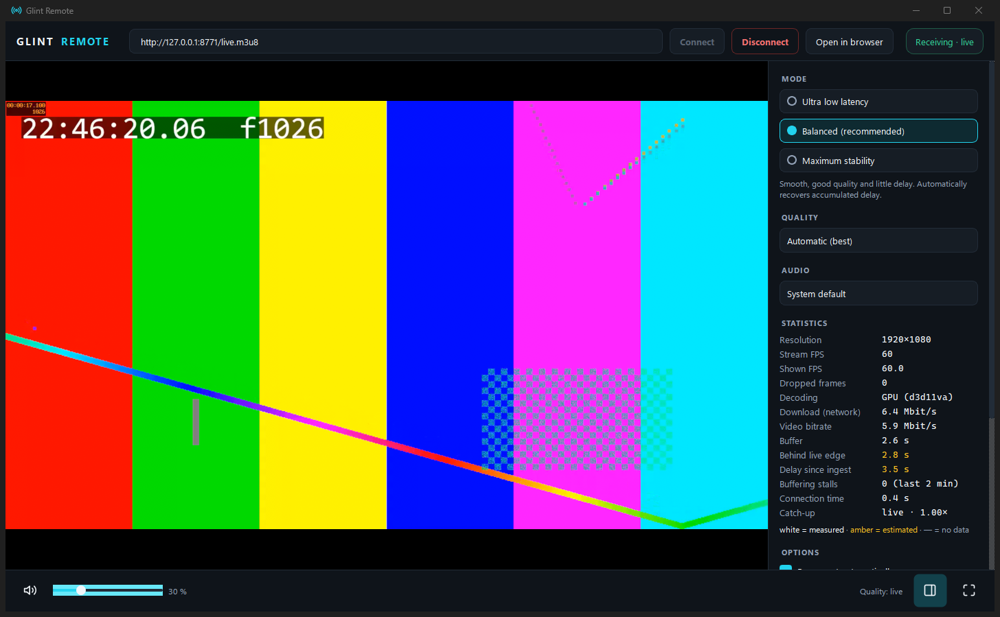

# Glint Remote Viewer

**Low-latency Windows desktop viewer for live gaming streams, built with Python, mpv and Streamlink.**

Watch a friend's console gameplay from another house, with sound and the least delay the streaming platform allows. No capture card is needed, the console isn't modified, and nobody shares passwords.


<sub>Screenshot of the real app playing a **synthetic test stream** (generated locally with FFmpeg), not a console.</sub>

## The problem it solves

You want to watch a friend play on their PlayStation 5 while you talk on Discord, but you live in different houses:

- Discord on PS5 can't share the screen.
- A capture card costs money.
- Remote Play takes over the console session and needs a capable PC at your friend's place.

The console's built-in **Broadcast** feature already streams to Twitch or YouTube using the PS5's own hardware encoder. **Glint Remote Viewer** is the receiving side. It's a lightweight player tuned to sit as close as possible to the live edge, so you see the game a few seconds after it happens, not 10–20 s later as in a browser tab.

```
PS5 (built-in Broadcast) → Twitch / YouTube → Glint Remote Viewer on your Windows PC
```

## Features

- **Three latency modes** that change real Streamlink and mpv parameters:
  - **Ultra low latency**
  - **Balanced** (default)
  - **Maximum stability**
- **Live-edge catch-up.** If playback falls behind, it speeds up slightly (1.03–1.06×, pitch-corrected audio). If it falls far behind, it jumps to the live edge, with a cooldown so it never "ping-pongs". You can turn this off.
- **GPU decoding (D3D11VA, zero-copy)** with `gpu-next` on Direct3D 11. On an RTX 3060, 1080p60 uses about 6–8 % of one CPU core.
- **Automatic reconnection** with exponential backoff. It also waits for a stream that hasn't started yet and connects on its own when it does.
- **Honest statistics:** resolution, source FPS and shown FPS, dropped frames, decoder, download rate, buffer, delay behind the live edge, delay since ingest, stalls and connection time. Each value is marked as *measured*, *estimated* or *unknown*. Nothing is made up.
- **Quality selection**, with automatic downgrade in stability mode when the connection keeps stalling.
- **Fullscreen** (F11, double-click), **volume and mute** (↑ ↓ M), and audio output device selection.
- **Private YouTube streams:** they are detected and explained. One click opens them in your normal browser, using your own Google session.
- **Persistent settings and channel history.** No credentials are stored, ever.
- **Exportable, sanitised logs.** Tokens, signatures, personal paths and private IPs are stripped.

## Compatibility

| | |
|---|---|
| OS | Windows 10/11, x64 (tested on Windows 11) |
| GPU | Any GPU with D3D11 video decoding (NVIDIA, AMD, Intel). Falls back to software decoding |
| Platforms | **Twitch** (recommended: low-latency HLS, 2 s segments) and **public or unlisted YouTube** live streams |
| Console side | PS5 **Broadcast** to Twitch or YouTube. Nothing to install at the broadcaster's place |

## Installation

1. Download `GlintRemote-Windows-x64.zip` from the [latest release](../../releases/latest).
2. Unzip it anywhere (right-click → *Extract All…*).
3. Double-click **`GlintRemote-Viewer.cmd`**.

No installer, no separate Python install and no admin rights are needed. If Windows asks *"Do you want to run this file?"*, choose **Run**.

**Why a `.cmd` launcher and not an `.exe`?** Windows 11 *Smart App Control* blocks any newly built executable that has no code-signing certificate and no reputation. Frozen executables (PyInstaller and similar) fall into that category, and there is no "run anyway" option. So the release ships the **official, digitally signed Python runtime, unmodified**, in `runtime\`, and the launcher just runs `runtime\pythonw.exe -m viewer`. This works with Smart App Control turned on. You don't need to disable any protection.

**To uninstall,** delete the folder. Settings are kept in `%APPDATA%\GlintRemote`.

## Usage

1. Your friend starts broadcasting from the PS5: **Create** button → **Broadcast** → Twitch → **Go Live**.
2. Type their Twitch channel name, or paste a Twitch or YouTube live URL, and press **Connect**.
3. Press **F11** for fullscreen.

Step-by-step guides:
- [GUIDE_BROADCASTER.md](GUIDE_BROADCASTER.md): for the person broadcasting from the PS5.
- [GUIDE_VIEWER.md](GUIDE_VIEWER.md): for the person watching.

## Latency modes

Measured on 2026-11-18. "Delay since ingest" runs from the platform's segment timestamp to the moment the frame is shown.

| Mode | Streamlink | mpv | Twitch arrival (public stream) | Local synthetic stream, end to end |
|---|---|---|---|---|
| Ultra | live-edge 2, low-latency, streamed segments | cache 2 s, readahead 1 s | ≈ 0.1 s after the segment timestamp | **1.7 s** |
| Balanced | live-edge 3, low-latency, streamed segments | cache 4 s, readahead 2 s | ≈ 0.1 s | 3.1 s |
| Stability | live-edge 4, normal latency | cache 12 s, readahead 6 s | ≈ 4.9 s | 4.4 s |

None of the three modes dropped a frame at 1080p60 in testing. Full results are in [TEST_RESULTS.md](TEST_RESULTS.md).

## Limitations

- **It does not capture a PS5 directly.** It plays a stream that the console sends to Twitch or YouTube. That's why no jailbreak or console modification is needed.
- **It can't remove the platform's own latency.** Console encoding, upload and platform ingest happen before the stream reaches this app. Expect a few seconds in total.
- **Twitch streams are public.** YouTube *unlisted* streams are hidden but shareable. YouTube **private** streams need an authorised Google account, so they open in your browser instead of the built-in player.
- **Some games block broadcasting of certain scenes**, such as cutscenes or menus. The viewer then sees the console's notice screen.
- YouTube doesn't publish segment timestamps, so delay can't be measured or caught up there. Twitch gives noticeably lower latency.
- Not affiliated with, endorsed by or sponsored by Sony Interactive Entertainment, Twitch or Google/YouTube. "PlayStation", "PS5", "Twitch" and "YouTube" are trademarks of their respective owners.

## Development

```powershell
git clone <URL of this repository>     # green "Code" button on GitHub
cd Glint-Remote-Viewer
powershell -ExecutionPolicy Bypass -File build.ps1     # venv + deps + verified libmpv + lint + tests + portable ZIP
.venv\Scripts\python -m viewer                         # run from source
.venv\Scripts\python -m pytest                         # all tests (the integration ones need ffmpeg on PATH)
```

`build.ps1` downloads `libmpv-2.dll` from the official Windows builds that mpv.io links to (shinchiro/mpv-winbuild-cmake) and **checks its SHA-256** before using it.

**Project layout:**

| Path | Purpose |
|---|---|
| `viewer/bridge.py` | Streamlink inside the same process, per-segment timestamp tracking, zero-copy hand-off to mpv |
| `viewer/player.py` | libmpv wrapper (custom `stream_cb` protocol with a single `memmove` per block) |
| `viewer/session.py` | Connect, reconnect, catch-up, adaptive quality, metrics |
| `viewer/profiles.py` | The three modes: the only place their parameters live |
| `viewer/ui.py` | PySide6 interface and `--bench` automated test mode |
| `tools/synthetic_hls.py` | Reproducible local 1080p60 HLS test stream with a burned-in clock |
| `tools/platform_latency.py` | Measures how quickly Twitch or YouTube deliver segments |
| `tools/build_portable.py`, `tools/make_zip.py` | Build the portable release (signed official Python runtime + app + libmpv) |

**Automated benchmark of one mode against the synthetic source:**

```powershell
.venv\Scripts\python tools\synthetic_hls.py --port 8765
.venv\Scripts\python -m viewer --bench http://127.0.0.1:8765/live.m3u8 --profile ultra --seconds 60 --actions --out bench.json
.venv\Scripts\python tools\bench_summary.py bench.json
```

**Contributing:** issues and pull requests are welcome. Run `pytest` before opening a pull request.

## License

GPL-3.0-or-later. See [LICENSE](LICENSE).

Release builds bundle third-party components under their own licences:
- libmpv and FFmpeg: GPL.
- Qt / PySide6: LGPL-3.0, dynamically linked.
- Streamlink: BSD-2-Clause.
- python-mpv: GPL/LGPL.
- requests: Apache-2.0.

Notices and sources are listed in [LICENSES/THIRD_PARTY.txt](LICENSES/THIRD_PARTY.txt).
